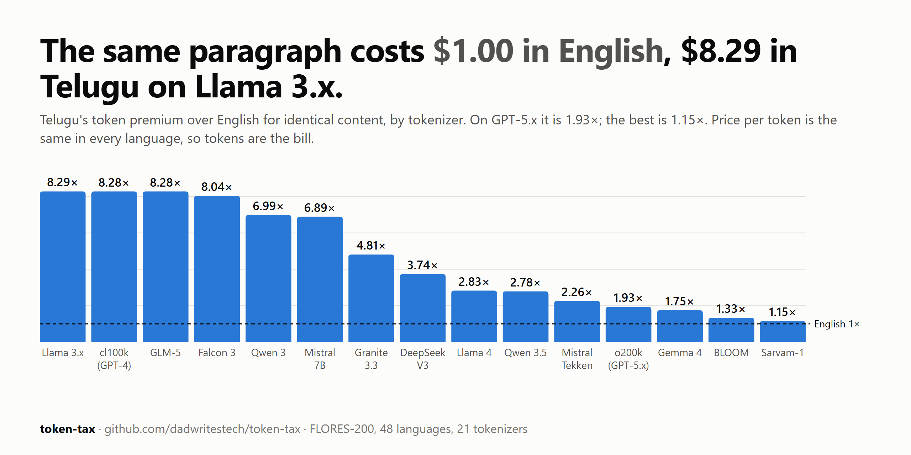

# token-tax

[English](README.md) · [తెలుగు](README.te.md) · **हिन्दी**

**Llama 3 पर एक ही पैराग्राफ़ की क़ीमत अंग्रेज़ी में $1.00 है और तेलुगु में $8.29। GPT-5.x पर तेलुगु के लिए यह $1.93 है और अम्हारिक के लिए $5.81।**



LLM APIs प्रति token के हिसाब से बिल करते हैं, और एक tokenizer एक ही मतलब को भाषा के हिसाब से बहुत अलग-अलग संख्या के tokens में बदल देता है। token-tax इसी अंतर को एक parallel corpus (FLORES-200) पर **21 tokenizers और 48 भाषाओं** के लिए मापता है, और फिर तारीख़ वाली price sheet (`prices.yaml`) से इसे डॉलर में बदलता है। कहीं भी कोई AI model नहीं चलाया गया; सिर्फ़ tokenizers।

**आज़माएँ:** अपना टेक्स्ट [कैलकुलेटर](https://dadwritestech.github.io/token-tax/calculator.html) में पेस्ट करें। यह असली tokenizers आपके ब्राउज़र में ही चलाता है, और आपका टेक्स्ट पेज से बाहर नहीं जाता। हर tokenizer × हर भाषा के [चार्ट](https://dadwritestech.github.io/token-tax/) भी देखें।

लोकल तौर पर (कुछ install नहीं करना; नतीजे repo में ही हैं):

```bash
git clone https://github.com/dadwritestech/token-tax && python -m http.server 8791 --directory token-tax/site
```

फिर http://localhost:8791 खोलें।

## आँकड़े क्या कहते हैं

- Llama 3 में भारतीय भाषाओं के लिए पुराने GPT-4 tokenizer की कमज़ोरी बनी रही: तेलुगु 8.29×, तमिल 7.65×। Meta ने हिंदी सुधारी (4.78× से 2.53×), लेकिन द्रविड़ भाषाएँ नहीं। Llama 4 ने इसका ज़्यादातर हिस्सा ठीक कर दिया (तेलुगु 2.83×)।
- Gemma 3 और Gemma 4 सबसे संतुलित हैं: औसतन 1.69×, और कोई भी भाषा 3.4× (ओड़िया) से ज़्यादा नहीं।
- GPT-5.x (o200k) पर तेलुगु 1.93× और हिंदी 1.57× है।
- Sarvam-1, जो ख़ास भारतीय भाषाओं के लिए बना tokenizer है, तेलुगु में लगभग अंग्रेज़ी के बराबर है (1.15×), लेकिन बर्मी भाषा के लिए 14.2×।
- Context window भी उसी अनुपात में सिकुड़ जाती है: GLM-5 की 204,800-token window में लगभग 165,000 शब्दों का अंग्रेज़ी कंटेंट आता है, लेकिन तेलुगु कंटेंट सिर्फ़ 20,000 अंग्रेज़ी शब्दों के बराबर।

पूरी तालिकाएँ (हर tokenizer, हर model की क़ीमत), तरीक़ा और reproduce करने के कदम [अंग्रेज़ी README](README.md) में हैं।

## जो नहीं मापा गया: Claude, Gemini

Anthropic और Google अपने tokenizers प्रकाशित नहीं करते; गिनती के लिए उनका API चाहिए। इसलिए ये rows जानबूझकर ख़ाली हैं, अनुमान नहीं लगाए गए। अगर आपके पास API key है, तो मापे गए नंबरों के साथ pull request भेजें: [CONTRIBUTING.md](CONTRIBUTING.md)।

## सीमाएँ

FLORES समाचार और Wikipedia से लिया गया औपचारिक, अनुवादित टेक्स्ट है। चैट, code-mixed टेक्स्ट (Hinglish, Tenglish) और रोमन लिपि में लिखी हिंदी अलग तरह से tokenize होते हैं, इसलिए अपने टेक्स्ट पर कैलकुलेटर इस्तेमाल करें। यह premium सिर्फ़ tokens मापता है, उस भाषा में model के जवाबों की गुणवत्ता नहीं।

## License

कोड Apache-2.0 ([LICENSE](LICENSE)); नंबर और चार्ट CC BY 4.0 ([DATA_LICENSE](DATA_LICENSE)): लिंक के साथ "token-tax by dadwritestech" का क्रेडिट दें। FLORES के sample वाक्य CC BY-SA 4.0 हैं।

<sub>यह अनुवाद पहले एक local model (gemma-4-12b) से ड्राफ़्ट किया गया और फिर हाथ से सुधारा गया। कोई ग़लती दिखे तो issue या PR भेजें। अंग्रेज़ी README ही मानक है।</sub>
