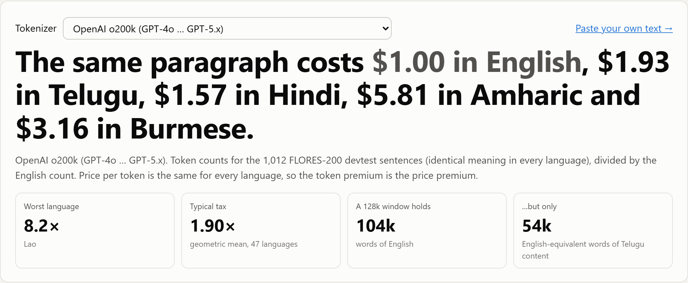
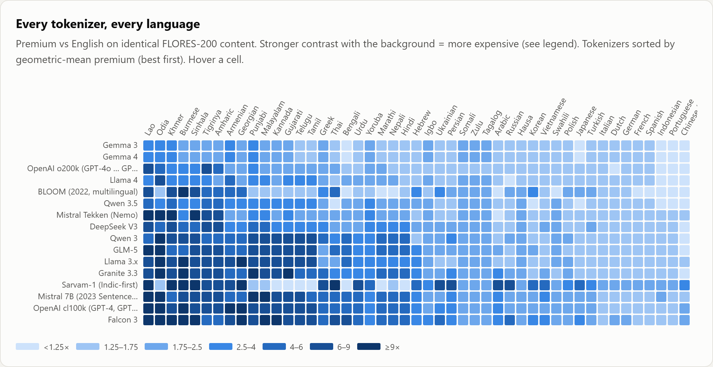
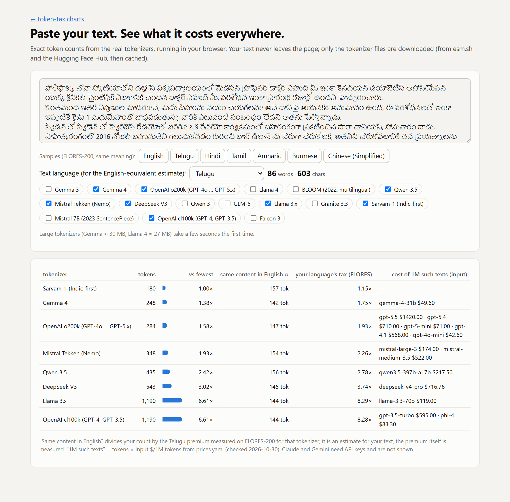

# token-tax

**The same paragraph costs $1.00 in English, $1.93 in Telugu and $5.81 in Amharic on GPT-5.x. On Llama 3 it costs $8.29 in Telugu and $11.65 in Burmese.**

LLM APIs bill per token, and a tokenizer turns the same meaning into very different numbers of tokens depending on the language. token-tax measures that gap for 21 real tokenizers (16 distinct ones) across 48 languages. It uses one parallel corpus and the vendors' named tokenizers, with dated prices. It is the 2023 tokenizer-fairness result ([Petrov et al., NeurIPS 2023](https://arxiv.org/abs/2305.15425)), priced and kept current.



- **Charts:** `site/index.html` (headline, bars, every-tokenizer × every-language heatmap, model price table)
- **Calculator:** `site/calculator.html`. Paste your own text; the real tokenizers run in your browser and nothing is sent anywhere.
- **No LLM inference anywhere.** Only tokenizers.

## Headline numbers

Measured 2026-10-30 on FLORES-200 devtest (1,012 sentences with the same meaning in every language). The **premium** is that language's tokens divided by the tokens for the same English content.

| tokenizer | Telugu | Hindi | Tamil | Amharic | Yoruba | Burmese | Arabic | Chinese (Simplified) | German | geomean (47 langs) | worst |
|---|---|---|---|---|---|---|---|---|---|---|---|
| Gemma 3 | 1.75× | 1.30× | 1.45× | 1.90× | 2.33× | 2.36× | 1.45× | 1.08× | 1.32× | 1.69× | Odia 3.4× |
| Gemma 4 | 1.75× | 1.30× | 1.45× | 1.90× | 2.33× | 2.36× | 1.45× | 1.08× | 1.32× | 1.69× | Odia 3.4× |
| OpenAI o200k (GPT-4o … GPT-5.x) | 1.93× | 1.57× | 1.98× | 5.81× | 2.13× | 3.16× | 1.38× | 1.25× | 1.31× | 1.90× | Lao 8.2× |
| Llama 4 | 2.83× | 1.65× | 3.75× | 2.39× | 2.47× | 3.15× | 1.59× | 1.06× | 1.30× | 1.95× | Odia 8.4× |
| BLOOM (2022, multilingual) | 1.33× | 1.28× | 1.29× | 5.03× | 1.56× | 10.02× | 1.15× | 0.91× | 1.68× | 2.03× | Burmese 10.0× |
| Qwen 3.5 | 2.78× | 1.98× | 2.53× | 4.26× | 2.54× | 3.34× | 1.30× | 0.91× | 1.30× | 2.04× | Khmer 5.1× |
| Mistral Tekken (Nemo) (= Large 3, Medium 3.5) | 2.26× | 1.80× | 2.18× | 7.46× | 2.74× | 3.25× | 1.24× | 1.40× | 1.30× | 2.29× | Khmer 14.7× |
| DeepSeek V3 (= V4) | 3.74× | 2.79× | 3.07× | 6.01× | 2.81× | 5.33× | 1.62× | 0.94× | 1.51× | 2.51× | Lao 8.0× |
| Qwen 3 | 6.99× | 4.43× | 6.11× | 4.08× | 2.69× | 8.96× | 1.63× | 1.01× | 1.56× | 3.00× | Odia 9.7× |
| GLM-5 | 8.28× | 4.33× | 7.64× | 7.62× | 2.69× | 5.98× | 1.77× | 0.95× | 1.45× | 3.15× | Odia 12.4× |
| Llama 3.x | 8.29× | 2.53× | 7.65× | 7.62× | 2.70× | 11.65× | 1.65× | 1.28× | 1.58× | 3.17× | Odia 12.2× |
| Granite 3.3 | 4.81× | 4.52× | 4.55× | 6.13× | 2.53× | 9.34× | 2.65× | 1.25× | 1.59× | 3.20× | Odia 10.5× |
| Sarvam-1 (Indic-first) | 1.15× | 1.13× | 1.16× | 6.88× | 4.00× | 14.17× | 6.45× | 3.65× | 2.12× | 3.29× | Burmese 14.2× |
| Mistral 7B (2023 SentencePiece) | 6.89× | 4.37× | 5.61× | 6.18× | 2.76× | 7.85× | 3.33× | 1.55× | 1.56× | 3.45× | Odia 11.5× |
| OpenAI cl100k (GPT-4, GPT-3.5) (= Phi-4, OLMo-2) | 8.28× | 4.78× | 7.64× | 7.63× | 2.93× | 11.65× | 3.03× | 1.87× | 1.59× | 3.81× | Odia 12.5× |
| Falcon 3 | 8.04× | 4.70× | 8.24× | 5.79× | 3.04× | 11.22× | 3.26× | 1.98× | 1.81× | 4.07× | Kannada 12.8× |

All 48 languages, with tokens per word and per character, are in `results/summary.json`.

What stands out:

- **Llama 3 kept cl100k's Indic weakness.** Its Telugu, Tamil, Amharic and Burmese premiums match cl100k to two decimals. Meta extended the vocabulary with Hindi (4.78× on cl100k → 2.53× on Llama 3), but not the Dravidian languages. Llama 4 fixed most of this.
- **Gemma has the best geometric mean** (1.69×), and its worst language is only 3.4×. Every other tokenizer's worst language is at 5× or more.
- **A specialist tokenizer moves the tax around.** Sarvam-1 is near parity on Indic languages (Telugu 1.15×), but Chinese is 3.65× and Burmese 14.2×.
- **Chinese is cheaper than English on Qwen 3.5, BLOOM, GLM-5 and DeepSeek** (0.91–0.95×).
- **The newer vendor tokenizers are not uniformly better.** Mistral Tekken charges 14.7× for Khmer, and GLM-5 (2026) charges about as much as cl100k (2023) for Telugu.



## What it costs in dollars

Input $ per 1M **English-equivalent words**: the price of content whose English translation is 1M words. Dividing by English word count avoids the "what is a word in Thai" problem.

| model | English | Telugu | Hindi | Tamil | Amharic | Burmese | Arabic | Chinese | context window holds (Telugu content, English-equivalent words) |
|---|---|---|---|---|---|---|---|---|---|
| gpt-5.5 | $6.14 | $11.83 | $9.65 | $12.14 | $35.68 | $19.41 | $8.48 | $7.67 | 1,050,000 tok → 443,657 (vs 855,571 English) |
| gpt-5.4 | $3.07 | $5.92 | $4.83 | $6.07 | $17.84 | $9.71 | $4.24 | $3.83 | 1,050,000 tok → 443,657 (vs 855,571 English) |
| gpt-5-mini | $0.31 | $0.59 | $0.48 | $0.61 | $1.78 | $0.97 | $0.42 | $0.38 | 400,000 tok → 169,012 (vs 325,932 English) |
| gpt-4.1 | $2.45 | $4.73 | $3.86 | $4.86 | $14.27 | $7.76 | $3.39 | $3.07 | 1,047,576 tok → 442,632 (vs 853,596 English) |
| gpt-4o-mini | $0.18 | $0.36 | $0.29 | $0.36 | $1.07 | $0.58 | $0.25 | $0.23 | 128,000 tok → 54,084 (vs 104,298 English) |
| gpt-3.5-turbo | $0.62 | $5.14 | $2.97 | $4.74 | $4.73 | $7.23 | $1.88 | $1.16 | 16,385 tok → 1,593 (vs 13,199 English) |
| deepseek-v4-pro | $1.63 | $6.09 | $4.55 | $5.00 | $9.80 | $8.69 | $2.64 | $1.53 | 1,000,000 tok → 216,578 (vs 809,769 English) |
| mistral-large-3 | $0.64 | $1.43 | $1.14 | $1.38 | $4.74 | $2.06 | $0.79 | $0.89 | 262,144 tok → 91,349 (vs 206,281 English) |
| mistral-medium-3.5 | $1.91 | $4.30 | $3.42 | $4.15 | $14.22 | $6.19 | $2.37 | $2.67 | 262,144 tok → 91,349 (vs 206,281 English) |
| glm-5 | $1.24 | $10.29 | $5.38 | $9.49 | $9.46 | $7.43 | $2.19 | $1.18 | 204,800 tok → 19,912 (vs 164,962 English) |
| llama-4-maverick | $0.23 | $0.66 | $0.38 | $0.87 | $0.56 | $0.73 | $0.37 | $0.25 | 524,288 tok → 150,142 (vs 424,458 English) |
| llama-3.3-70b | $0.12 | $1.03 | $0.31 | $0.95 | $0.95 | $1.45 | $0.21 | $0.16 | 131,072 tok → 12,745 (vs 105,630 English) |
| qwen3.5-397b-a17b | $0.65 | $1.81 | $1.29 | $1.65 | $2.77 | $2.18 | $0.85 | $0.60 | 262,144 tok → 72,331 (vs 201,157 English) |
| qwen3-235b-a22b-2507 | $0.11 | $0.79 | $0.50 | $0.69 | $0.46 | $1.02 | $0.18 | $0.11 | 262,144 tok → 29,723 (vs 207,819 English) |
| gemma-4-31b | $0.26 | $0.45 | $0.33 | $0.37 | $0.49 | $0.61 | $0.37 | $0.28 | 262,144 tok → 116,789 (vs 204,132 English) |
| phi-4 | $0.09 | $0.72 | $0.42 | $0.66 | $0.66 | $1.01 | $0.26 | $0.16 | 16,384 tok → 1,593 (vs 13,198 English) |

The **effective context window** shrinks by the same factor. GLM-5's 204,800-token window holds about 165k English-equivalent words of English but only about 20k of Telugu. Output prices and native-word context (for spaced scripts) are in `results/summary.json`.

### Not measured: Claude, Gemini, GPT-6

Anthropic and Google don't publish their tokenizers; the only way to count tokens is their APIs. Those rows are **empty slots, not estimates**. To fill them, set the key(s) and run:

```bash
ANTHROPIC_API_KEY=... GEMINI_API_KEY=... python -m tokentax.measure --api && python -m tokentax.report
```

This calls only the free token-counting endpoints (no generation), and subtracts the per-request overhead measured on `"."`. GPT-6 has a price in `prices.yaml`, but tiktoken 0.14 doesn't ship its encoding, so it stays unmeasured.

## Calculator



`site/calculator.html` loads the same tokenizers in the browser, using js-tiktoken for OpenAI and transformers.js for the HF tokenizers. It shows exact counts for your text, an estimate of what the same content would cost in English (your count ÷ the FLORES premium for the language), and the price of 1M such texts per model. On the Telugu sample, all 16 browser tokenizers give exactly the same counts as the Python pipeline.

## Method

- **Corpus:** [FLORES-200](https://github.com/facebookresearch/flores/tree/main/flores200) devtest, 1,012 sentences × 48 languages (CC BY-SA 4.0). FLORES+ is gated on Hugging Face, so v0 uses the original tarball.
  - FLORES-200 contains CSV-escaped doubled quotes (`""`), e.g. 231 of them in Telugu. `clean()` collapses them and NFC-normalises the text.
  - The effect on counts is ≤0.1%. Uncleaned counts for three tokenizers are in `results/counts_raw.json`.
- **Counting:** each language's sentences are joined with `\n` and tokenised as one document, with no special tokens (no BOS/EOS).
- **Metrics** (`tokentax/metrics.py`, unit-tested):
  - premium = tokens_L / tokens_en
  - $/1M English-equivalent words = tokens_L / words_en × price
  - context words = context × words / tokens_L
  - summary = geometric mean of premiums over the 47 non-English languages
- **Identical tokenizers are merged.** Tokenizers that produce identical counts on all 48 languages are shown as one row:
  - Phi-4 and OLMo-2 = cl100k
  - DeepSeek V4 = V3
  - Mistral Large 3 and Medium 3.5 = Tekken
  - Gemma 3 and 4 differ by 3 tokens in total, so both are shown.
- **Gated repositories** (meta-llama, google/gemma-3) are read from ungated mirrors (`unsloth/...`) that ship the identical `tokenizer.json`. `tokentax/registry.py` lists the exact source of each one.
- **OpenAI tokenizer per model** follows tiktoken 0.14's model map (`gpt-5*` → o200k_base). This is OpenAI's own published mapping, not a measurement against the live API.

## Prices

`prices.yaml` is dated (`checked: 2026-10-30`), and every row links to the page it was read from.

- **First-party prices** are used where the lab sells the model itself: OpenAI, DeepSeek (peak rate), Mistral and Z.ai.
- **Open-weight models** are priced from OpenRouter's listing; a snapshot is committed at `data/raw/openrouter/models.json`. Other hosts charge different prices.
- **To update:** edit `prices.yaml`, rerun `python -m tokentax.report`, and commit. The git history becomes the price history.

## Reproduce

```bash
pip install -r requirements.txt
```

```bash
mkdir -p data/raw && curl -L -o data/raw/flores200.tar.gz https://dl.fbaipublicfiles.com/nllb/flores200_dataset.tar.gz && tar -xzf data/raw/flores200.tar.gz -C data/raw
```

```bash
python -m tokentax.measure && python -m tokentax.report
```

```bash
python -m pytest
```

```bash
python -m http.server 8791 --directory site
```

Measuring needs about 1 GB of Hugging Face downloads (tokenizer files only, cached in `.hfcache/`). `scripts/screenshot.py` re-renders `docs/` with Playwright.

## Limitations (v0)

- **Input side only.** The headline compares input tokens. Output tokens carry the same premium, and output prices are in `summary.json`.
- **FLORES is formal, translated news and wiki text.** Chat, code-mixed text (Hinglish, Tenglish) and romanised scripts will tokenise differently. Use the calculator for your own text.
- **The premium covers tokens only.** It says nothing about the quality a model delivers in that language.
