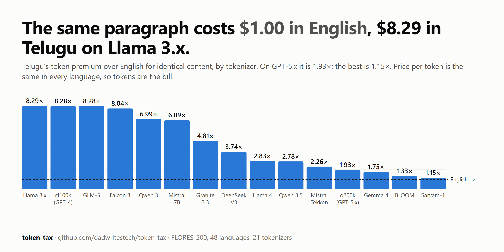

# token-tax

[English](README.md) · **తెలుగు** · [हिन्दी](README.hi.md)

**Llama 3 లో ఒకే పేరాగ్రాఫ్‌కి ఇంగ్లీష్‌లో $1.00 ఖర్చయితే, తెలుగులో $8.29 అవుతుంది. GPT-5.x లో తెలుగుకి $1.93, అమ్హారిక్‌కి $5.81.**



LLM APIs ప్రతి token కి బిల్ చేస్తాయి. ఒకే అర్థాన్ని ఒక tokenizer భాషను బట్టి చాలా వేర్వేరు సంఖ్యలో tokens గా మారుస్తుంది. token-tax ఆ తేడాని ఒకే ప్యారలల్ కార్పస్ (FLORES-200) మీద **21 tokenizers, 48 భాషల** కోసం కొలిచి, తేదీతో కూడిన ధరల పట్టిక (`prices.yaml`) సాయంతో డాలర్లలోకి మారుస్తుంది. ఇక్కడ ఏ AI model నీ రన్ చేయలేదు; కేవలం tokenizers మాత్రమే.

**ట్రై చేయండి:** మీ సొంత టెక్స్ట్‌ని [కాలిక్యులేటర్‌](https://dadwritestech.github.io/token-tax/calculator.html)లో పేస్ట్ చేయండి. అది అసలైన tokenizers ని మీ బ్రౌజర్‌లోనే రన్ చేస్తుంది; మీ టెక్స్ట్ ఆ పేజీ దాటి ఎక్కడికీ వెళ్ళదు. ప్రతి tokenizer × ప్రతి భాష [చార్ట్‌ల](https://dadwritestech.github.io/token-tax/)లో ఉన్నాయి.

లోకల్‌గా (install అవసరం లేదు; ఫలితాలు repo లోనే ఉన్నాయి):

```bash
git clone https://github.com/dadwritestech/token-tax && python -m http.server 8791 --directory token-tax/site
```

తర్వాత http://localhost:8791 ఓపెన్ చేయండి.

## డేటా ఏం చెబుతోంది

- Llama 3 పాత GPT-4 tokenizer బలహీనతను భారతీయ భాషల్లో అలాగే ఉంచేసింది: తెలుగు 8.29×, తమిళం 7.65×. Meta హిందీని మెరుగుపరిచింది (4.78× నుండి 2.53× కి), కానీ ద్రావిడ భాషలను కాదు. Llama 4 లో చాలావరకు సరిచేశారు (తెలుగు 2.83×).
- Gemma 3, Gemma 4 అన్నిటికంటే సమతుల్యంగా ఉన్నాయి: సగటున 1.69×, ఏ భాషా 3.4× (ఒడియా) కంటే ఎక్కువ కాదు.
- GPT-5.x (o200k) లో తెలుగు 1.93×, హిందీ 1.57×.
- భారతీయ భాషల కోసమే తయారైన Sarvam-1 tokenizer లో తెలుగు దాదాపు ఇంగ్లీష్‌తో సమానం (1.15×), కానీ బర్మీస్‌కి 14.2×.
- Context window కూడా అదే నిష్పత్తిలో తగ్గిపోతుంది: GLM-5 యొక్క 204,800-token window లో సుమారు 165,000 పదాల ఇంగ్లీష్ కంటెంట్ పడుతుంది, కానీ తెలుగు కంటెంట్ అయితే కేవలం 20,000 ఇంగ్లీష్ పదాలకు సమానమైనంత మాత్రమే.

పూర్తి పట్టికలు (ప్రతి tokenizer, ప్రతి model ధర), పద్ధతి, reproduce చేసే విధానం [ఇంగ్లీష్ README](README.md) లో ఉన్నాయి.

## కొలవనివి: Claude, Gemini

Anthropic, Google తమ tokenizers ని బయటపెట్టవు; లెక్కించాలంటే వాళ్ళ API కావాలి. అందుకే ఆ వరుసలు కావాలనే ఖాళీగా వదిలేశాం, అంచనాలు వేయలేదు. మీ దగ్గర API key ఉంటే, కొలిచిన నంబర్లతో pull request పంపండి: [CONTRIBUTING.md](CONTRIBUTING.md).

## పరిమితులు

FLORES అంటే న్యూస్, Wikipedia నుండి తీసుకున్న ఫార్మల్, అనువదించిన టెక్స్ట్. చాట్, కోడ్-మిక్స్‌డ్ టెక్స్ట్ (Tenglish, Hinglish), రోమన్ లిపిలో రాసిన తెలుగు వేరేలా tokenize అవుతాయి, కాబట్టి మీ సొంత టెక్స్ట్‌తో కాలిక్యులేటర్‌ని వాడండి. ఈ premium కేవలం tokens ని మాత్రమే కొలుస్తుంది, ఆ భాషలో model ఇచ్చే సమాధానాల నాణ్యతను కాదు.

## License

కోడ్ Apache-2.0 ([LICENSE](LICENSE)); నంబర్లు, చార్ట్‌లు CC BY 4.0 ([DATA_LICENSE](DATA_LICENSE)): లింక్‌తో పాటు "token-tax by dadwritestech" అని క్రెడిట్ ఇవ్వండి. FLORES శాంపిల్ వాక్యాలు CC BY-SA 4.0.

<sub>ఈ అనువాదాన్ని ముందుగా ఒక local model (gemma-4-12b) తో డ్రాఫ్ట్ చేసి, తర్వాత చేత్తో సరిచేశాం. ఏదైనా తప్పు కనిపిస్తే issue లేదా PR పంపండి. ఇంగ్లీష్ README నే ప్రామాణికం.</sub>
